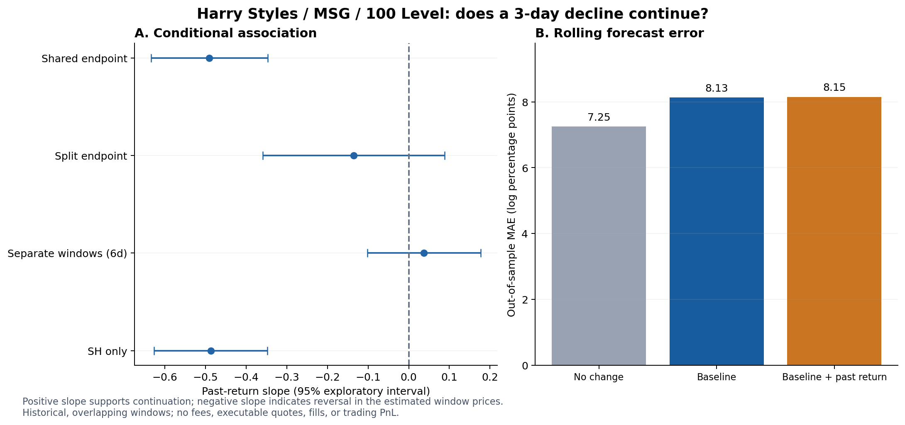

# Harry Styles / MSG：第二个交易研究假说

数据整理、3天价格动量检验与观众疲劳研究线索 · 2026-09-28

## 结论先行

**目前没有可靠证据支持：控制倒计时、座位差异及共同市场变化后，过去3天跌得更多，未来3天会继续跌得更多。**

普通算法出现较强反转关系，但它共用了一个有测量噪声的近期价格水平。拆分该端点以后，系数明显接近0，区间跨过0；进一步避免共享窗口也没有可靠的动量证据。因此既不应宣布找到下跌动量，也不应把初始负系数包装成已验证的反转策略。

滚动预测中，增加过去3天收益后，MAE由8.13变为8.15个对数百分点，没有改善；“价格不变”的MAE仅7.25，更好。现有复杂模型尚未通过简单基准检验。

这是一项有明确可证伪假说、数据审计、统计控制、基线对比与防泄漏检查的研究。结果不支持最初设想也是有效结果，但当前不能称为可盈利交易系统。



## 1. 本次整理了什么

新上传15份文件共14,726条记录。9/30与10/2两份文件内容完全一致，均为1,203行，已保留但隔离；两份不能算两场独立数据。此前已确认的9/30旧文件sales_data.csv有1,277行，与争议新文件没有完全相同的交易行，继续作为旧快照使用。这不证明新文件属于哪一场，仍须重导核实。

**当前分析范围：29场、37,021条接受的原始记录；100 Level 14,745条，其中普通座位且开场前的合格记录14,434条。** 另外保留2,406条隔离记录；全部31份输入合计39,427行。原Q1结果未改写。

| 来源文件 | 演出日期 | 原始行数 | 100 Level | 状态 |
| --- | --- | --- | --- | --- |
| 15-0930.csv | 2026-09-30 | 1203 | 454 | 隔离：文件内容冲突 |
| 14-1002.csv | 2026-10-02 | 1203 | 454 | 隔离：文件内容冲突 |
| 13-1003.csv | 2026-10-03 | 1083 | 390 | 纳入 |
| 12-1007.csv | 2026-10-07 | 1088 | 453 | 纳入 |
| 11-1009.csv | 2026-10-09 | 1035 | 375 | 纳入 |
| 10-1010.csv | 2026-10-10 | 1123 | 378 | 纳入 |
| 09-1014.csv | 2026-10-14 | 1065 | 388 | 纳入 |
| 08-1016.csv | 2026-10-16 | 942 | 363 | 纳入 |
| 07-1017.csv | 2026-10-17 | 1050 | 388 | 纳入 |
| 06-1021.csv | 2026-10-21 | 876 | 350 | 纳入 |
| 05-1023.csv | 2026-10-23 | 828 | 296 | 纳入 |
| 04-1024.csv | 2026-10-24 | 994 | 373 | 纳入 |
| 03-1028.csv | 2026-10-28 | 820 | 311 | 纳入 |
| 02-1030.csv | 2026-10-30 | 721 | 287 | 纳入 |
| 01-1031.csv | 2026-10-31 | 695 | 305 | 纳入 |

文件只有七个原始字段，没有真实event_id、sale_id或listing_id。日期依赖用户文件映射；开始时间为MSG官方排期20:00纽约当地时间，不是歌手实际上台时间。30日/31日Harryween也按官方时间处理。[MSG场次时间来源](https://www.msg.com/events-tickets/harry-styles-jamie-xx-madison-square-garden-october-2026/3B00643506AE83A2)。

### 新上传文件的质量检查

| 检查 | 数量 | 处理 |
| --- | --- | --- |
| 本次原始记录 | 14726 | 包含两份隔离文件；原始值全部保留 |
| 100 Level记录 | 5565 | 未清洗前 |
| Qty=0 | 6090 | 未知数量，不作零票或一票 |
| 缺失Zone | 44 | 不猜补座位大类 |
| 缺失Row | 787 | 其中100 Level缺失29条 |
| 100 Level非普通Row | 6 | 保留原始标签，主模型不用 |
| 100 Level特殊Section | 14 | 14条WC标签，不等于错误 |
| 完全相同行候选 | 6 | 3组6行、额外3行；无sale_id不能证明重复交易 |
| 文件级冲突 | 2 | 9/30与10/2两文件逐字节相同，各1,203行 |
| 价格或时间无法解析 | 0 | 均为0 |
| 价格>$10,000 | 14 | 14条；本次最高$415,881，标记待核查 |
| 对数价格MAD极值标记 | 84 | 84条，启发式标记，不自动删除 |
| Qty>8 | 30 | 30条，审查阈值不是平台限购 |
| 冬季时区解释差异 | 2840 | EDT表头与纽约冬令时不同；保留两种解析 |

上表口径为本次15份原始上传，包含隔离文件，因此不是主模型样本量。缺失和极值不是互斥分类，不可相加当作总问题行数。数量异常0条、未知来源0条、新文件开场后记录0条。

原始七列均逐值保留，并附加场次日期、来源文件、原始行号、哈希、时间戳、精确距开场小时/天数、异常标记及是否入模。没有把可疑金额自动除100，也没有根据结果选删样本。候选重复默认保留，另做去重敏感性。

**倒计时分箱保留原规则**：(0,12]小时、(12,24]、(24,48]、(48,96]、(96,168]、>168小时；正好12小时属于12小时以内。原始小时/天数不四舍五入。开场时刻及之后单列。Q2用连续倒计时，完整未来3天窗口需在开场前结束，所以不覆盖最后72小时的3天预测。

SeatData价格不含手续费，Qty=0是未知数量。sh部分价格/数量依赖挂牌补充；vs观察计数是下界。CSV不是全市场销量或全部实际入场统计。[FAQ](https://docs.seatdata.io/docs/faq/) · [销售接口说明](https://docs.seatdata.io/docs/api/reference/v1/getEventSales/)。仍没有经过核实的统一100 Level官方票面标准价，因此本研究不用虚构票面价作锚。

## 2. 假说和可比价格怎样定义

主假说H1：过去3天收益系数β>0；过去收益越负，未来收益也越负，才叫持续下跌。β<0是反转方向，不能算支持H1。

研究对象为普通100 Level、Section101–120、数字Row1–22。这是沿用的保守可比范围，不是在断言其他座位不存在。每个72小时窗口至少5条、覆盖至少2个Section；不够就没有信号，不插值。

每日纽约20:00，用当时之前60天的价格拟合座位调整模型：log价格 ~ Section + Row + 来源 + Qty组 + 场次 + 售出日期 + 倒计时的非线性函数。只扣除座位/来源/数量构成项，保留价格随时间的变化。该时点系数冻结用于随后标签；没有借用Q1全样本基准，也没有用未来价格重新校准过去的座位差异。

```text
A = (t−6天, t−3天] 的调整后log价格中位数
B = (t−3天, t]     的调整后log价格中位数
C = (t, t+3天]     的调整后log价格中位数

过去收益 x = B − A
未来收益 y = C − B
```

这些是3天窗口价格水平的变化，不是精确到t这一瞬间的可执行报价。相同Section/Row仍可能有视线、具体座号和票种差异未观察到；“已控制座位”只指已记录的这些变量。

### 如何控制共同市场

**关联检验**：y ~ βx + 倒计时非线性项 + 场次固定效应 + 预测日期固定效应。日期效应吸收跨场次的同日共同变化；它是事后控制，不能拿未来日历效应做实时预测。

**滚动预测**：基线用倒计时、场次及其他场次过去收益的中位数（排除本场、至少5个同行场次）；候选模型仅多加一个本场过去收益项。这个共同因子只代表Harry/MSG系列，不代表整个美国票务市场，也不能消除所有异质新闻反应。

## 3. 条件关联结果

| 检验 | 场次×预测日样本 | 过去收益系数β | 探索性95%区间 |
| --- | --- | --- | --- |
| 普通算法 | 791 | -0.490 | [-0.634, -0.347] |
| 普通算法：限拆分检验同样本 | 501 | -0.430 | [-0.542, -0.319] |
| 拆分同一近期窗口 | 501 | -0.136 | [-0.359, 0.088] |
| 完全不共享窗口 | 692 | 0.038 | [-0.102, 0.177] |
| 仅sh：拆分端点 | 443 | -0.116 | [-0.329, 0.096] |

普通算法的约−0.49不应直接解读为赚钱的反转规律。因为近期价格B若偶然偏高，会同时把x推高、把y压低；即使真实价格没有反转，也会出现负相关。

拆分检验按稳定记录内容哈希把B分成两半：一半只用于过去收益，另一半只用于未来收益基准，各半仍需5条、2个Section。在**同样501个样本**上，共用端点系数−0.430，拆分后为−0.136。这与共享测量误差影响结果相符，但不能证明全部差异都来自该误差。

完全不共享窗口的检验预测“未来第4至6天相对第1至3天”的变化，系数约+0.038、区间跨0。它需要未来6天，不能冒充原始3天预测的完全替代检验。

区间按场次和预测日历周处理相关性，取双向及两个单向方差中较保守者。主检验只有9个日历周簇，拆分检验仅6个，区间是探索性的；重叠窗口与估计价格误差仍会限制统计把握，不能把791个观测当作791次独立实验。

## 4. 真正按时间往前走的预测

原计划8月1日起评价，但满足最少120条成熟训练样本、15个训练日后，主模型实际从8月19日才开始。每个预测时刻只用已经结束的标签训练，测试行不随机拆分。没有成熟标签的场次使用训练样本平均场次效应，预测表明确标注；这也是跨场外推的限制。

**647个可评价预测，29场、37个预测日，8月19日至9月24日**。共生成701个过去信息合格的预测；54个无法评价，其中41个尚未完整走完未来窗口，13个未来成交记录不足。主信号在2,275个候选场次日中只有869个具备信号和共同因子，覆盖率38.2%；不能假设每天每场都能交易。

| 模型 | MAE：对数百分点 | RMSE：对数百分点 | 涨跌方向准确率 |
| --- | --- | --- | --- |
| 价格不变 | 7.25 | 9.16 | — |
| 倒计时＋场次＋过去共同市场 | 8.13 | 10.43 | 57.2% |
| 基线＋本场过去3天收益 | 8.15 | 10.28 | 57.8% |

MAE是平均绝对预测误差，越低越好；8.15个对数百分点不是8.15%的盈利，也不是8.15美元。单笔误差要转为价格比例需用exp(误差)−1。

加信号的MAE差值为+0.018个对数百分点（候选减基线，负值才是改善）；7天日历块重抽样的探索性95%区间为[-0.645, 0.707]，跨0。没有可靠的增量改善。样本中未来下跌比例为64.8%，而加入信号后的方向准确率为57.8%，连“一直猜下跌”的方向基准也没有超过。

### 规定的敏感性检查

| 检查 | 可评价预测数 | 基线MAE | 加信号MAE | 误差变化 |
| --- | --- | --- | --- | --- |
| 拆分端点 | 289 | 8.53 | 8.77 | +0.24 |
| 不共享窗口（未来6天） | 521 | 8.25 | 8.37 | +0.12 |
| 训练额外隔开6天 | 584 | 8.34 | 9.50 | +1.16 |
| 仅sh | 636 | 8.25 | 8.28 | +0.03 |
| 候选重复行去重 | 647 | 8.13 | 8.16 | +0.03 |
| 固定排除价格>$10,000 | 647 | 8.13 | 8.15 | +0.02 |

拆分端点、避免共享窗口，以及训练多隔开6天时，加入过去收益并未带来稳定改善。去重与固定极值检查不能改变总体判断。不同检查的可评价样本和目标有差别，不能横向把最低误差挑出来当最佳策略。

条件概率也不是统一结论：在距演出3–7天的61个样本中，未来下跌的总体比例约78.7%，过去已跌样本中约86.7%；但在14–30天样本中相应约68.1%与63.6%。小样本、日历共同变化和窗口重叠下，这些描述不足以证明增量预测价值。

## 5. 能否拿来决定买卖

当前不应只因过去3天下跌，就机械推迟买入、抛售库存或扩大头寸。也不应因普通算法显示反转就反向加仓。模型需要先在新增、真正未见的数据上稳定胜过简单基线。

本研究没有可执行买卖价、买卖费用、连续挂牌库存、未成交/撤单过程与自己的成交概率，因此没有计算交易PnL、最高买价或仓位。历史成交价不是你当时一定能买到或卖出的价格。

若后续要进入决策阶段，应先把目标改为可执行净卖价/售出概率，并接入买入费用、卖出费用、临近开场未售出的损失和资金/库存上限。在那之前，这是一份信号研究与否定性验证结果。

## 6. 时间与研究可信度

新数据最大记录时间为9月28日17:43 EDT，日度研究截至9月27日20:00。旧9/30文件只能覆盖更早的完整时段。每份文件按最后记录之前最近一次20:00作为保守完整截止点，这是操作性假设，不是平台完整性认证。

CSV缺少“该条记录首次何时对用户可见”。平台说明采集间隔可能从5分钟到12小时不等，历史文件也可能被回填或修订。因此本次是按记录时间构造的历史滚动模拟，不能宣称在当时实际拥有完全相同的信息；未来真正的前瞻验证需要保存当日导出与发布时间。

这批已结束场次也已被Q1探索过，不能称为从未看过的独立保留集。本次实施细则在查看模型系数和误差前写定，但不是第三方注册的预注册试验。

已验证原文件哈希与七个原始字段、场次隔离、成熟标签训练与误差复算。另做未来扰动检查：把t之后的价格全部乘7，当时的信号和共同因子完全不变，未来标签按预期改变。这支持实现按记录时间隔离了未来价格，不能弥补缺少首次可见时间的问题。

**把握程度**：对文件冲突与清理统计把握高；对“这版模型尚未证明动量预测价值”把握中高；对“市场永远没有动量/存在可交易反转/观众疲劳导致销量下降”均没有足够依据。

## 7. 新闻与第三个假说

检索截至：2026年9月28日。范围以8月26日MSG开演至9月28日为主。以下是选取的相关报道，不是完整媒体语料或情绪指数。

## 找到的热度叙述

| 发布日期 | 来源 | 与研究有关的信息（转述） | 证据边界 |
|---|---|---|---|
| 2026-08-28 | [Vogue：How Does Harry Styles’s Garden Show Grow?](https://www.vogue.com/article/harry-styles-madison-square-garden-review) | 将这轮30场MSG驻演描述为售罄，现场评价积极。 | 媒体的售罄描述不等于每场二级市场价格、真实入场率或逐日新增需求。 |
| 2026-09-10 | [Pitchfork：Harry Styles Reveals 2027 Tour Dates](https://pitchfork.com/story/harry-styles-reveals-2027-tour-dates/) | 报道新增2027年北美与欧洲巡演日期。 | 可作为新增替代场次公布的新闻日期；不能单靠公告证明MSG价格因此下跌。 |
| 精确首次发布时间未核实；检索显示约9月中旬 | [FaceValue：Harry Styles Toronto: Buy or Wait?](https://facevalueto.ca/harry-styles-together-together-tour-2027/) | 作者讨论MSG场次多，并称第二轮巡演公布后转售价格走弱，附TicketData图表。 | 独立票务评论，不是经审计销量报告；疲劳与新增城市替代在文中混在一起。不能据此确认疲劳机制。 |

这些报道可以同时成立：一级市场曾售罄，与二级市场后来折价，并不矛盾。本次没有找到可直接用来确认“MSG后期实际入场率持续下降”的逐场、可比、经核实统计。

## 第三步应该检验什么

把大问题拆开：

1. **后期场次折价**：在相同距离开场天数、相同普通100 Level座位、相同来源下，较晚演出的调整价格是否较低？这是价格关联问题。
2. **交易活跃度变化**：在相同售票阶段、固定来源和稳定监测覆盖下，后期场次的观察到的交易笔数是否较少？这是样本内活跃度问题。
3. **观众疲劳机制**：即使前两项成立，是否能排除新增巡演分流、供给增加、经纪商去库存、周末/首场/末场/Harryween与市场整体变化？目前不能。

不要直接比较8月26日与10月31日全部历史平均价或CSV总行数。前者已结束，后者还有一个月售票期；低价席位和来源比例也可能不同。

## 用现有数据能先做的设计

**固定提前期比较**：先选每场开演前7至14天，逐场计算可比座位价格、观察到的交易笔数、已知数量合计、未知数量比例。各场需要完整经历这个窗口才进入。10月较晚场次现在还未达到该窗口，留空，不作零。

**拟合关联模型**：log价格 ~ 演出序号 + 距开演时间函数 + Section + Row + 来源 + Qty组 + 星期/周末 + 特殊场次标记。日历时间可用受限制的趋势项或新闻分段做敏感性，但不能称为完全消除了日历混杂。

**重要识别限制**：同一个驻演系列中，“截至某日已经演了几场”完全由日历日期决定，加入完整日期固定效应后它会被吸收；“这一场排第几”在每场内固定，加入场次固定效应后同样会被吸收。也不能通过删掉一个变量就声称得到了疲劳的因果效应。倒计时、演出日期和观察日期之间还存在确定关系，任何趋势分解都依赖模型约束。

**9月10日公告事件图**：对公告前后均有完整记录的相同场次画调整价格变化，保持场次集合、座位与来源口径固定。预设前后各7天，另列9月15–16日新巡演售票时段。它是可能的结构变化检查；当前数据没有未受影响的对照组，不能把变化唯一归因于公告。

**更强的下一步**：补其他歌手或其他地区在相同日历期的票务数据，并记录新增巡演城市对各地区买家的替代程度；若要识别真正的疲劳，还需要重复观演比例、受众地域、搜索兴趣或调查信息。结果应先叫“后期场次折价/成交活跃度”，再讨论可能机制。

## 为销量研究补的数据

- 每天同一时刻记录的可售挂牌数量、挂牌票张数、主办方新增放票与价格、平台是否持续监测。
- 尽可能取得listing_id/sale_id/真实平台event_id，以识别跨平台重复与历史导出修订。
- 分开保存实际观察交易笔数和已知售出票张数；Qty=0是未知，不补成1，也不将未知总量称为完整销量。
- 来源覆盖开始/结束时间及采集延迟。SeatData文档明确vs计数是观察下界，sh有些价格与数量依赖挂牌补充，因此CSV不等于全市场售票或入场统计。

数据语义来源：[SeatData销售接口](https://docs.seatdata.io/docs/api/reference/v1/getEventSales/)；[FAQ](https://docs.seatdata.io/docs/faq/)。场次与时间：[MSG官方页面](https://www.msg.com/events-tickets/harry-styles-jamie-xx-madison-square-garden-october-2026/3B00643506AE83A2)。10月30和31日为Harryween，第三步需单独标记。

## 新闻如何进入未来研究

保存标题、URL、首次发布时间、抓取时间、事件发生时间、来源类型、原始事实和研究者推断。未知发布时间的FaceValue文章本次只作机制线索，不放入历史实时信号。Vogue的报道用于“报道时点的舆情”，不倒填为8月26日前已知信息。

当前证据判断：对“存在热度与降价的不同媒体叙述”把握较高；对“演出过多造成观众疲劳并降低后续销量”尚无足够证据。

## 8. 文件使用

- 总清理表：sales_enriched_all_files.csv，原始列保留；先看included_in_research和identity_status。
- 新文件审计：quality_by_event_new_uploads.csv、identity_checks.csv、event_manifest.csv。
- 模型复核：panel_*.csv、conditional_coefficients.csv、oos_metrics.csv、predictions_*.csv。
- 方法与复现：两个protocol、README、clean_data.py、analyze_q2.py、finalize_analysis.py、verify.py。
- latest_research_signals_not_trade_orders.csv是事后重建的9/27快照，不是9/27已发布过的前瞻预测或下单指令。

需要用户补齐的唯一文件问题：重新导出9月30日和10月2日，并保留各自网页event_id；两份当前相同文件不能靠改名解决。
